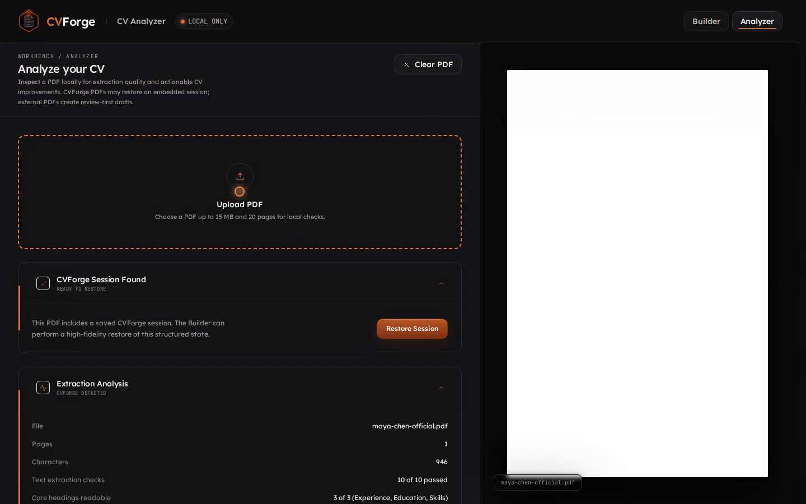

# CVForge

**Local-first CV builder and ATS-style CV analyzer.** Create a structured CV with browser autosave, live PDF preview, and portable backups. Then analyze machine readability and get transparent feedback without server-side storage or accounts.

An open-source product from [Anvilary Tools](https://anvilary.tools).

**Live Application:** [cvforge.anvilary.tools](https://cvforge.anvilary.tools)

---

## Product Demonstration

Watch the complete **Builder → PDF Export → Analyzer** workflow in action (50 seconds, 1440×900, authentic browser recording):

[](docs/media/cvforge-demo.mp4)

> 📹 **[Click here to watch the full HD demonstration video (MP4, 1.6 MB)](docs/media/cvforge-demo.mp4)**

<details>
<summary><strong>Video Scene Breakdown & Demonstration Transcript</strong></summary>

1. **Scene 1: Initial Viewport & Navigation (0:00 - 0:05)**: Opening the CVForge homepage, showing the full-viewport hero and launching the Builder through the modal.
2. **Scene 2: Structured Editing (0:05 - 0:16)**: Editing Maya Chen's candidate profile (contact information, professional summary, work experience, education, and skills).
3. **Scene 3: Live PDF Canvas Preview (0:16 - 0:24)**: Instant rendering of the document model onto the HTML5 canvas preview; interacting with Zoom In and Fit-to-Width dock controls.
4. **Scene 4: Layout & Document Customization (0:24 - 0:28)**: Inspecting document styling, typography, spacing margins, and A4/Letter formatting.
5. **Scene 5: PDF Export (0:28 - 0:32)**: Downloading the generated machine-readable PDF with its embedded full-fidelity structured session (`cvforge-state.json`).
6. **Scene 6: Navigation to Analyzer (0:32 - 0:37)**: Navigating to `/analyzer` and selecting the freshly exported PDF file.
7. **Scene 7: Genuine Analysis Results (0:37 - 0:46)**: Local text extraction, detecting the embedded session for instant restoration, displaying the 69/100 ATS-style score, breakdown across six dimensions, and actionable improvement recommendations.
8. **Scene 8: Conclusion (0:46 - 0:50)**: Returning to the clean workbench overview.

*Note: All candidate names, employers, and contact details shown in the demonstration are fictional.*
</details>

---

## Why CVForge?

- **Zero Cloud Storage**: Your CV data never leaves your computer. Everything runs in your browser via WebAssembly and client-side JavaScript.
- **No Sign-Up or Accounts**: Start immediately without email registration, passwords, or subscriptions.
- **ATS-Optimized Output**: Generates clean, single-stream, machine-readable PDFs with recognized section headings, standard bullet glyphs, and searchable fonts.
- **Lossless Portability**: Exported PDFs contain an embedded structured session. Uploading your PDF to CVForge on any device restores your exact structured CV data.
- **Transparent Scoring**: Evaluates candidate resumes across 6 key dimensions using clear, deterministic rules rather than opaque AI models.

---

## Quick Start

You can use CVForge directly without installing anything:

1. **Open the Builder**: Visit [cvforge.anvilary.tools/builder](https://cvforge.anvilary.tools/builder).
2. **Fill Your Information**: Enter your experience, skills, and education while viewing the live preview.
3. **Download PDF & JSON**: Click **Download** for your printable resume, and **Export** for a standalone JSON backup.
4. **Analyze Your Document**: Navigate to [cvforge.anvilary.tools/analyzer](https://cvforge.anvilary.tools/analyzer) to inspect ATS parseability, heading clarity, and impact metrics.

---

## Key Features

### CV Builder
- **Structured Sections**: Profile, Work Experience, Education, Projects, Skills, Languages, and Custom Sections.
- **Section Controls**: Up/down reordering, visibility toggling, and custom section renaming.
- **Live Canvas Preview**: Real-time rendering driven by `pdfjs-dist` and `@react-pdf/renderer` with DPI-aware canvas scaling.
- **Document Styling**: A4 and US Letter page sizes, typography scale, line-height adjustments, section spacing, and accent themes.

### CV Analyzer
- **Direct or Uploaded Analysis**: Analyze the active Builder CV in memory or upload an external PDF (up to 15 MB, 20 pages).
- **Embedded Session Recovery**: Instant 1-click restoration when a CVForge PDF is uploaded.
- **Review-First Draft Import**: External PDFs are parsed using spatial heuristics; users review extracted fields before replacing local state.
- **Deterministic Scoring (Method v3)**: 100-point evaluation across *Completeness*, *Structure*, *Clarity*, *Impact*, *ATS Compatibility*, and *Parseability*.

---

## Data Ownership & Privacy

| Format | Purpose | Details |
| :--- | :--- | :--- |
| **Browser Storage** | Local autosave | Saved to `localStorage` under `cvforge:state`. Pauses automatically if conflicting edits occur in another tab. |
| **JSON Backup** | Full-fidelity backup | Recommended long-term storage format. Fully portable across browsers and devices. |
| **CVForge PDF** | Printable & restorable export | Carries an embedded `cvforge-state.json` attachment in the PDF catalog for lossless session restoration. |
| **External PDF** | Analysis & heuristic import | Extracted entirely in-browser. Requires user confirmation before updating Builder data. |

> [!IMPORTANT]
> Because CVForge is strictly local-first, clearing browser cookies/site data removes your local autosave. **Always export a JSON backup** after significant edits.

---

## Technology Stack

- **Framework**: [Next.js](https://nextjs.org/) (App Router, Standalone build output)
- **UI & State**: [React 19](https://react.dev/), [TypeScript](https://www.typescriptlang.org/), [Tailwind CSS](https://tailwindcss.com/)
- **Data Validation**: [Zod](https://zod.dev/) schemas and versioned migration pipelines
- **PDF Rendering**: [@react-pdf/renderer](https://react-pdf.org/) and [pdf-lib](https://pdf-lib.js.org/)
- **PDF Extraction**: [pdfjs-dist](https://mozilla.github.io/pdf.js/) running in a client Web Worker
- **Testing**: [Vitest](https://vitest.dev/) (unit tests), [Playwright](https://playwright.dev/) (end-to-end), and [Axe](https://www.deque.com/axe/) (accessibility)

---

## Local Development

### Prerequisites
- Node.js **22.13 or newer** (below Node 23)
- `pnpm` **10.5.2** (managed via Corepack)

### Setup & Run

```bash
# Clone the repository
git clone https://github.com/Anvilary/CVForge.git
cd CVForge

# Enable pnpm via Corepack
corepack enable
corepack prepare pnpm@10.5.2 --activate

# Install dependencies
pnpm install --frozen-lockfile

# Start development server
make dev
```

Open `http://127.0.0.1:3000` in your browser.

### Verification Commands

```bash
pnpm typecheck           # TypeScript validation
pnpm lint                # ESLint code style
pnpm test:unit           # Vitest unit test suite (30 files, 326 tests)
pnpm test:e2e:chromium   # Playwright end-to-end acceptance tests
pnpm check:em-dash       # Enforce Anvilary prose guidelines
pnpm build               # Production standalone bundle
```

### Local Production Preview

To test the optimized standalone server locally:

```bash
NEXT_PUBLIC_SITE_URL=https://cvforge.anvilary.tools make preview-build
make preview-start       # Starts on http://127.0.0.1:3030
make preview-status
make preview-stop
```

---

## Documentation Directory

- 📖 **[User Guide](docs/user-guide.md)**: Detailed step-by-step guide for Builder, Analyzer, and data recovery workflows.
- 📄 **[ATS and PDF Compatibility](docs/ats-and-pdf.md)**: Technical guide on machine-readable PDF generation, text integrity, and parser limits.
- 🏛️ **[System Architecture](docs/architecture.md)**: Modular design, data contracts, state reducer, and privacy boundaries.
- 🚀 **[Deployment Runbook](docs/deployment.md)**: Standalone Docker builds, Nginx reverse proxy, and Cloudflare Tunnel operations.
- 🔒 **[Clean-Room Specification](docs/clean-room.md)**: Repository origin, independence from third-party derivatives, and licensing policies.
- 🧪 **[Release QA Plan](docs/current-qa-plan.md)**: Complete manual QA checklist, cross-browser matrices, and viewport test plans.

---

## Known Boundaries & Honest Limitations

- **No Commercial ATS Equivalence**: Proprietary ATS platforms (Workday, Taleo, Greenhouse) use differing commercial parsers. CVForge adheres to best-practice text standards but cannot guarantee third-party acceptance.
- **Embedded Session Boundary**: Embedded session restoration is an internal CVForge portability feature using a standard PDF attachment. It allows 100% loss-free restoration within CVForge, but external ATS systems extract the plain text stream rather than reading the embedded session.
- **PDF-Only Analyzer**: Image-only scans, DOCX, and plain-text files are not supported. CVForge does not use cloud OCR services.
- **Language Diagnostics**: Deep grammatical and heading diagnostics are explicitly tested for English and Portuguese (Portugal), with language-neutral fallbacks for other languages.
- **Browser Origin Isolation**: Browser security models separate `localStorage` across different domains. Use JSON export/import to move your CV between different URLs or profiles.

---

## License

CVForge is open-source software maintained by [Alexandre Teixeira](https://github.com/alteixeira20) and distributed under the **[MIT License](LICENSE)**.
